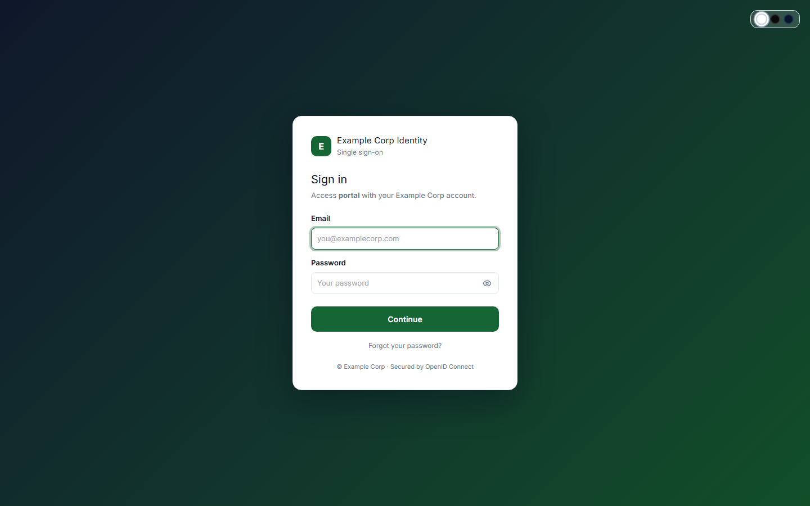
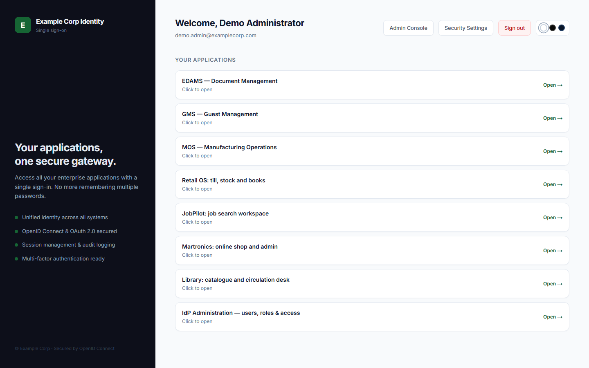
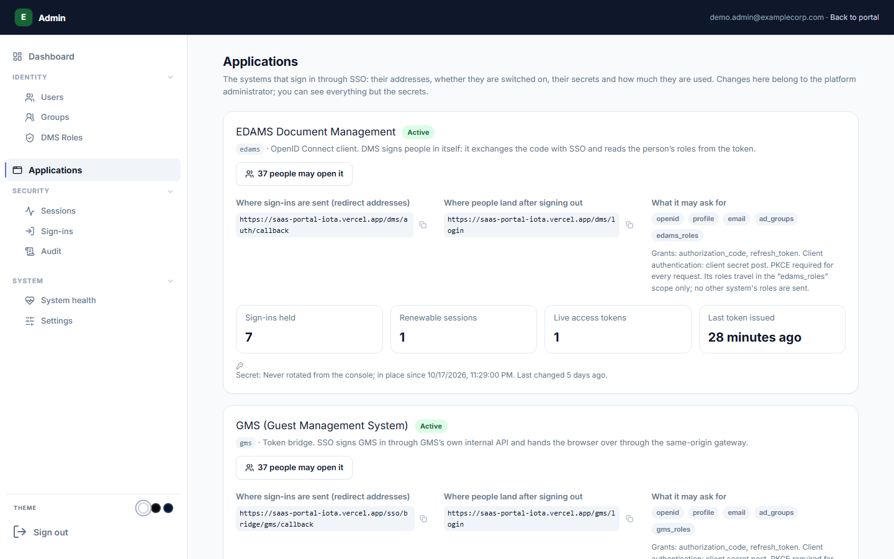
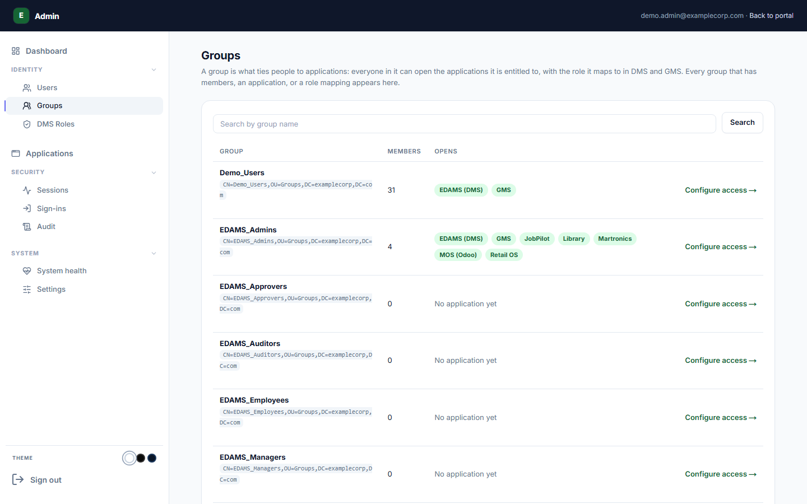
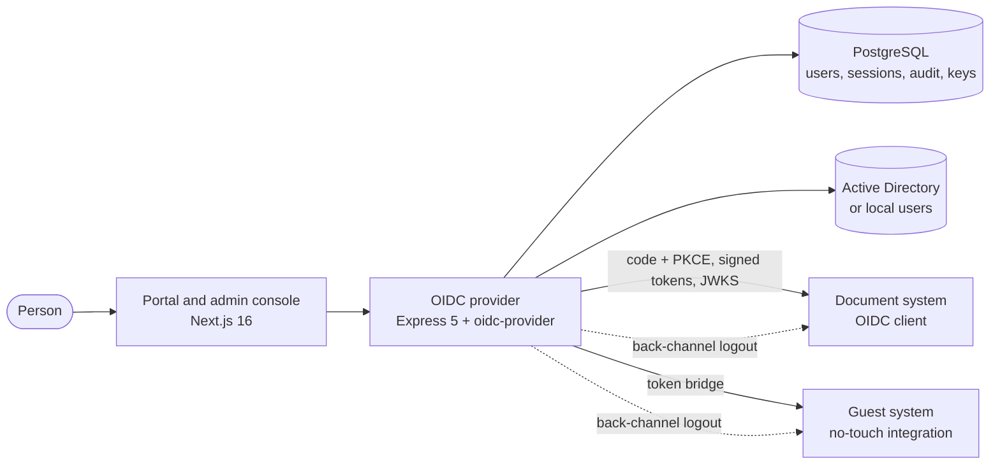

# Identity Platform (SSO)

A custom OpenID Connect identity provider with an admin console and an application launcher: one sign-in for every system in an organisation. I chose to build it in-house after evaluating Keycloak, Authentik and Zitadel, because the platform needed identity rules of its own (per-application roles, a hash-chained audit trail, offline-signed licences) that are easier to own than to bolt on.

> **This is the public showcase.** It holds the write-up, screenshots and a live demo. The source code is private; see [Source access](#source-access).

| | |
|---|---|
| **What it is** | OpenID Connect provider, admin console and application launcher |
| **Stack** | Node.js, TypeScript, Express 5, `oidc-provider`, PostgreSQL, Next.js 16 |
| **Quality** | 831 automated tests in 61 suites, with the test report generated and checked in CI |
| **Live demo** | [Identity portal](https://saas-portal-iota.vercel.app/sso/portal) |
| **My role** | Architect and lead engineer: requirements, design, build, deployment and verification |

## Try it live

1. Open the **demo access** card on the [portfolio](https://dawitbkportfolio.vercel.app/#demos) for the shared sandbox administrator login.
2. Sign in at the [identity portal](https://saas-portal-iota.vercel.app/sso/portal). The portal lists every connected application; choose one and you are signed in to it automatically.
3. Open the **Admin Console** to see users, groups, applications, sessions, sign-ins, the audit log and system health.

The demo runs on a personal machine behind a tunnel, so it is sometimes offline. The data is synthetic.

## Screenshots

| | |
|---|---|
|  |  |
| **Sign-in.** One page for every system, with a visible theme switch. | **Launcher.** Each person sees only the applications they may open. |
|  |  |
| **Applications.** Redirect addresses, allowed scopes, secret age and live usage per client. | **Groups.** A directory group decides which applications its members can open. |

## What it does

- **Standards-based sign-in.** Authorization code flow with PKCE required for every client, signed ID and access tokens (RS256) with a published key set, discovery document, user-info and end-session endpoints. Signing keys are managed from the console.
- **Central sign-out.** Signing out, or deactivating an account, ends the person's sessions in every connected application through back-channel logout.
- **Per-application roles.** The provider supplies identity and group membership; each application keeps its own role system. A client only receives the roles that belong to it, never another system's roles.
- **Identity sources.** Active Directory (LDAP) with a local user store as fallback.
- **Two ways to connect an application.** As a standard OIDC client (preferred, any language), or through a token bridge for an application whose own login cannot be changed. The guest management system connects this way.
- **Account security.** Optional TOTP two-factor sign-in with recovery codes, rate limiting, CSRF protection, password policy and a weak-password blocklist.
- **Admin console.** Users, groups, application entitlements, live sessions with "sign out everywhere", sign-in history, system health with plain-language checks, settings, security incidents and an owner verification flow.
- **Tamper-evident audit.** Every administrative action is written to a hash-chained log that can be searched, exported to CSV and verified for integrity from the console.
- **Licensing.** Offline-signed licences that connected systems verify without calling home, including a rule that a system tied to SSO ends with SSO.

## Architecture

### Design decisions

- **Two identity planes, not two systems.** Staff sign in through SSO. External and public flows (a guest's one-time-code sign-in, a signed document link, a public verification page) never go through the provider and keep working unchanged. SSO is opt-in per surface, never a global front door.
- **A portal and redirects, not a shell.** Each application keeps its own origin and frontend and is linked from the launcher. A single shell in front of everything would become a choke point and would fight public routes and legacy stacks.
- **The provider is role-agnostic on purpose.** It answers who you are; each application decides what you may do. External roles are never assigned by the provider.
- **Its own database.** No connected application shares a database with the provider.
- **Failure is visible.** The health page explains in plain language what is wrong and what to run, instead of showing a red light.

## Quality and operations

- 831 automated tests covering the OIDC flows, admin actions, audit chain, licensing, incident handling, client validation and edge cases such as client-address handling behind a proxy.
- Typed contracts at the boundaries, reviewed SQL migrations and least-privilege database access.
- A written requirements set (BRD, FRD, TDD), an architecture document, an integration guide with the exact settings and code for connecting a new system, an operations runbook, an audit report and a completion register.
- Releases are signed and rehearsed in a production-like environment before they reach the live server.

## Source access

The code is private. If you are hiring, collaborating or reviewing, I am happy to walk through it on a call or give read-only access to the repository. Email [dawitbk01@gmail.com](mailto:dawitbk01@gmail.com) or open an issue titled "Source access request".

## Related showcases

- [Document platform (DMS)](https://github.com/DawitBK/dms-showcase)
- [Guest platform (GMS)](https://github.com/DawitBK/gms-showcase)
- [Portfolio](https://dawitbkportfolio.vercel.app) and [resume](https://dawitbkportfolio.vercel.app/Dawit-Bayou-Kassie-Resume.pdf)

## About this repository

The text and screenshots are from the live sandbox, taken on 23 October 2026. Organisations and people shown are fictional ("Example Corp"). See [LICENSE](LICENSE): the text and images may be viewed and linked to; the software they describe is not part of this repository and is not licensed by it.
